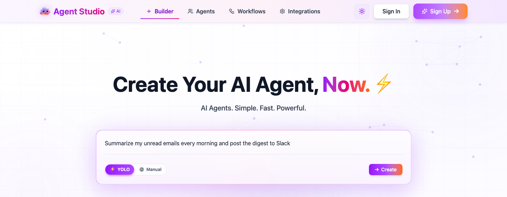
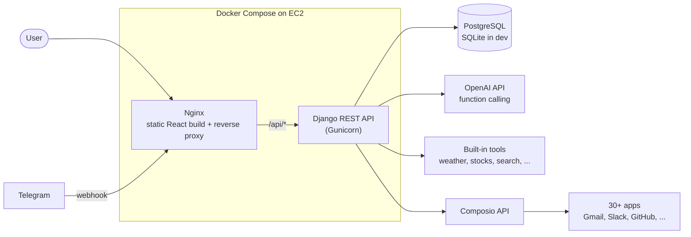
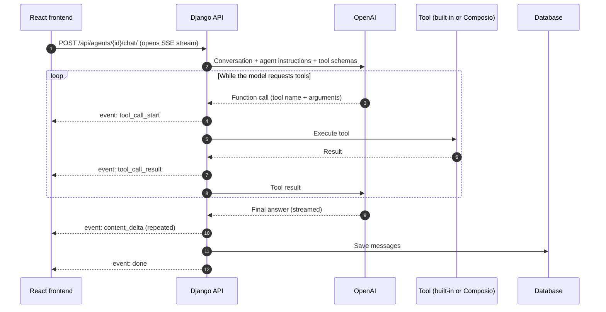

# Agent Studio

**Describe an AI agent in plain English, connect it to your apps, and put it to work.**

[](https://www.python.org/)
[](https://www.djangoproject.com/)
[](https://react.dev/)
[](https://www.typescriptlang.org/)
[](https://www.docker.com/)
[](LICENSE)



## What it does

Agent Studio is a full-stack platform for building AI agents without writing code. You describe what you want, and it creates an agent with the right instructions and tools. Agents can read and act on 30+ apps such as Gmail, Slack and GitHub, and you chat with them in real time. You can also run them on a schedule, trigger them from app events, or connect them to a Telegram bot.

## Features

### Agent Builder

Type a one-line description and YOLO mode generates the agent's name, instructions and tools for you. Manual mode walks through a 4-step wizard instead: basic info, files, tools and triggers. There are also 27 ready-made templates across 9 categories.


### Real-time Chat

Responses stream token by token over Server-Sent Events. When the agent calls a tool, the chat shows a live status card for the call and its result, so you can see what the agent is doing as it happens.

### Integrations

Agents connect to 30+ third-party apps through Composio OAuth, including Gmail, Google Drive, Slack, GitHub, Notion and HubSpot. Built-in tools cover weather, a calculator, stock quotes, YouTube search, web search and a website reader.

### Workflow Automation

A visual workflow builder (React Flow) chains agents together and runs them from a cron schedule, an app event such as a new email, or a manual trigger.

### Telegram Bots

Paste a bot token from BotFather and any agent becomes a Telegram bot. The backend verifies the token, registers a webhook, and replies to incoming messages with the agent.

## Architecture



### How a chat message flows



## Tech stack

| Layer | Technologies |
|---|---|
| Frontend | React 19, TypeScript, Vite, Tailwind CSS, shadcn/ui, Zustand, TanStack Query, React Flow |
| Backend | Django 4.2, Django REST Framework, Gunicorn, drf-spectacular (OpenAPI) |
| AI | OpenAI API (function calling), Composio |
| Data | PostgreSQL (Supabase) in production, SQLite in development |
| Infra | Docker Compose, Nginx reverse proxy, AWS EC2, Let's Encrypt |

## Getting started

### Prerequisites

- Python 3.12+
- Node.js 18+
- Docker and Docker Compose (optional, for containerized runs)
- An OpenAI API key and a Composio API key

### Backend

```bash
cd backend
python -m venv venv
source venv/bin/activate        # Windows: venv\Scripts\activate
pip install -r requirements.txt
cp .env.example .env            # then fill in your keys
python manage.py migrate
python manage.py seed_agent_templates   # optional: loads the 27 templates
python manage.py runserver
```

The API runs at `http://localhost:8000`.

### Frontend

```bash
cd frontend
npm install
cp .env.example .env
npm run dev
```

The app runs at `http://localhost:3000`.

### Docker

```bash
docker compose up -d --build
docker compose exec backend python manage.py migrate
```

The app is served at `http://localhost` and the API at `http://localhost/api/`.

## Environment variables

Copy each `.env.example` to `.env` and fill in your own values. `.env` files are git-ignored.

### Backend (`backend/.env`)

| Variable | Required | Purpose |
|---|---|---|
| `DJANGO_SECRET_KEY` | Required | Django secret key |
| `DEBUG` | Required | `True` in development, `False` in production |
| `ALLOWED_HOSTS` | Required | Comma-separated hostnames the API answers to |
| `CORS_ALLOWED_ORIGINS` | Required | Comma-separated frontend origins, e.g. `http://localhost:3000` |
| `CSRF_TRUSTED_ORIGINS` | Required | Comma-separated origins allowed to send CSRF-protected requests |
| `FRONTEND_URL` | Required | Frontend base URL, used in email links and redirects |
| `OPENAI_API_KEY` | Required | Runs the agents |
| `COMPOSIO_API_KEY` | Required | Third-party app integrations |
| `DATABASE_URL` | Optional | PostgreSQL connection string; SQLite is used when unset |
| `GOOGLE_CLIENT_ID` / `GOOGLE_CLIENT_SECRET` | Optional | Sign in with Google |
| `GITHUB_CLIENT_ID` / `GITHUB_CLIENT_SECRET` | Optional | Sign in with GitHub |
| `EMAILJS_*` | Optional | Verification and password-reset emails |
| `YOUTUBE_API_KEY` | Optional | YouTube search tool |
| `SERPAPI_KEY` | Optional | Web search tool |
| `ADMIN_URL` | Optional | Custom path for the Django admin |

### Frontend (`frontend/.env`)

| Variable | Required | Purpose |
|---|---|---|
| `VITE_API_URL` | Required | Backend base URL, e.g. `http://localhost:8000` |
| `VITE_FRONT_URL` | Required | Frontend base URL, used for share links and OAuth redirects |
| `VITE_GOOGLE_CLIENT_ID` | Required | Google OAuth client ID; the auth pages need a value to render |
| `VITE_GITHUB_CLIENT_ID` | Optional | GitHub OAuth client ID |
| `VITE_SUPPORT_AGENT_URL` | Optional | Public chat URL of an agent shown in the support chat widget |
| `VITE_MAIL_SUPPORT_TEAM` | Optional | Support email shown on the error page |

## Composio auth configs

`backend/auth_configs.json` maps each integration (Gmail, Slack, GitHub, and so on) to a Composio auth config ID. The committed file contains placeholders. Create your own auth configs in the [Composio dashboard](https://platform.composio.dev/) and replace each `your-composio-auth-config-id` with the matching `ac_...` ID from your account. The keys in this file also decide which apps `python manage.py sync_composio_apps` syncs.

## Deployment

The reference deployment runs on a single AWS EC2 instance with Docker Compose: Nginx serves the React build and proxies `/api/` to the Django container.

1. Provision an instance with Docker installed and ports 80 and 443 open.
2. Clone the repo and create `backend/.env` with production values (`DEBUG=False`, your domain in `ALLOWED_HOSTS`, `CORS_ALLOWED_ORIGINS` and `CSRF_TRUSTED_ORIGINS`, and a `DATABASE_URL`).
3. Build the frontend (`npm run build`) so `frontend/dist` exists, then run `docker compose up -d --build`.
4. Replace `yourdomain.com` and `YOUR_SERVER_IP` in `nginx/conf.d/app.conf` and issue certificates with Certbot.

`ec2-management.sh` prints ready-to-run SSH commands for logs, restarts, redeploys and health checks. Set `EC2_HOST` and `PEM_FILE` at the top of the script first.

## API

Interactive docs are generated with drf-spectacular:

- Swagger UI: `/api/docs/`
- ReDoc: `/api/docs/redoc/`
- OpenAPI schema: `/api/schema/`

## Project structure

```
├── backend/
│   ├── api_agents/          # Main app: agents, auth, tools, workflows, messaging, credits
│   ├── config/              # Django settings and URLs
│   ├── endpoints/           # API docs (Markdown)
│   └── auth_configs.json    # Composio auth config IDs (placeholders)
├── frontend/
│   └── src/
│       ├── components/      # Layout, pages (builder, chat, agents, workflows...), shared UI
│       └── lib/             # API client and utils
├── nginx/conf.d/            # Reverse proxy config
├── docs/images/             # README screenshots
├── docker-compose.yml
└── ec2-management.sh
```

## Security notes

- JWTs are stored in HttpOnly cookies, with CSRF protection enabled
- Third-party OAuth tokens are held by Composio, not stored in this app's database
- Containers run as a non-root user
- Secrets live only in `.env` files, which are git-ignored

## License

MIT. See [LICENSE](LICENSE).
